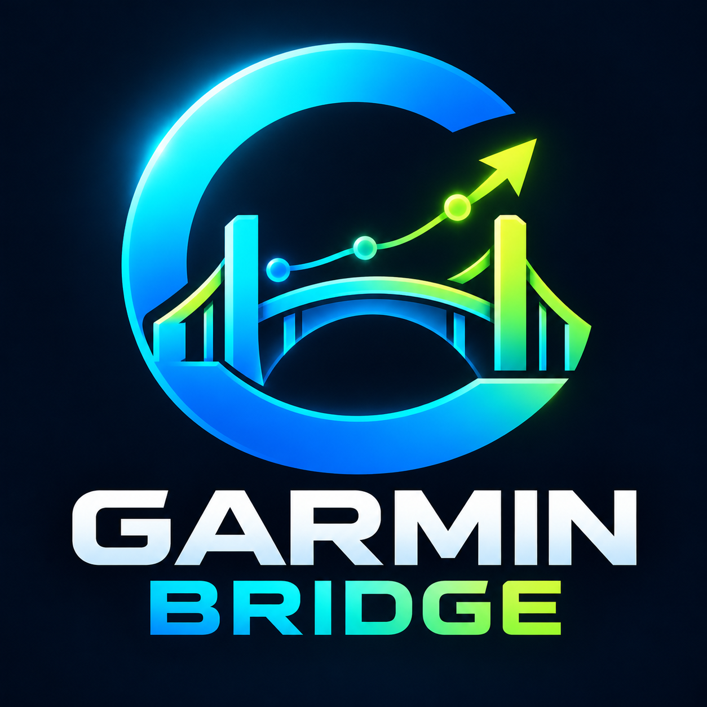

# Garmin Bridge

  

  

  <strong>Connect Garmin Connect with Coach AI.</strong> 
  A local Home Assistant add-on for Garmin Connect integration.

  

---

Local Garmin Bridge is a Home Assistant add-on that provides a local HTTP interface to Garmin Connect through the external [`garmin_mcp`](https://github.com/Taxuspt/garmin_mcp) project.

It is designed to support integrations and projects such as Coach AI that need to communicate with Garmin Connect.

## Features

- Runs as a Home Assistant add-on.
- Uses Home Assistant add-on options for Garmin Connect credentials.
- Supports the Streamable HTTP transport.
- Stores Garmin authentication tokens in the add-on data directory.
- Supports the `aarch64` architecture.

## Requirements

- Home Assistant with support for local add-ons.
- A compatible Garmin Connect account.
- Network access to the bridge from the clients that need it.

## Installation

1. Download or clone this repository.
2. Place the add-on folder in your Home Assistant local add-ons directory.
3. Refresh the local add-on store.
4. Install **Garmin Bridge**.
5. Enter your Garmin Connect credentials in the add-on configuration.
6. Start the add-on and review its logs.

Exact installation steps may vary depending on your Home Assistant setup.

## Configuration

The add-on accepts these options through Home Assistant:

- `garmin_username`
- `garmin_password`

Do not put credentials in source files, commit them to Git, or share your `options.json`.

## Network and security

The service listens on port `8000` and binds to `0.0.0.0` inside the container.

**Security warning:** do not expose this service directly to the public Internet. Restrict access to trusted local clients and use appropriate network controls. Verify the authentication and security characteristics of the upstream server before exposing it to other networks.

## Upstream dependency and attribution

This add-on installs and runs the external [`Taxuspt/garmin_mcp`](https://github.com/Taxuspt/garmin_mcp) project. That project is maintained separately and has its own license and attribution requirements.

This repository contains the Home Assistant add-on configuration and startup packaging; it does not claim authorship of the upstream project's source code.

## License

The MIT license in this repository applies to the files authored for Local Garmin Bridge, subject to the rights and licenses of third-party dependencies. See `LICENSE`.

## Contributions

Issues and pull requests are welcome. Please do not include passwords, Garmin authentication tokens, personal data, or unredacted logs in reports.

## Support the project

If Local Garmin Bridge is useful to you, you can help support its maintenance and development.

  <a href="https://buymeacoffee.com/fraberrojoh"><strong>☕ Buy me a coffee</strong></a>

  

